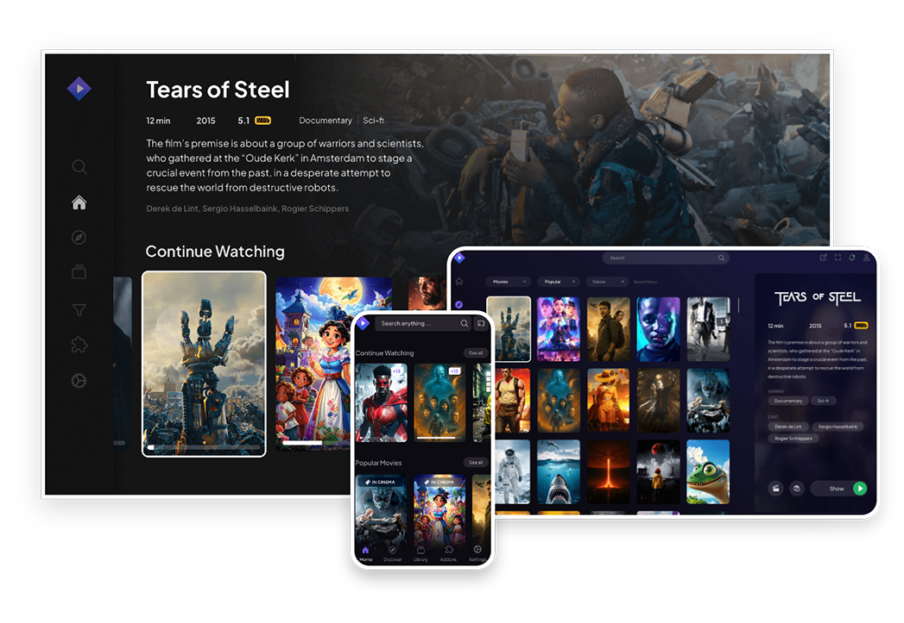

# Stremio-Setup

O [Stremio](https://github.com/Stremio) é um moderno centro de mídia, de código aberto, que oferece a liberdade de assistir tudo o que você deseja, com a possibilidade de assistir diversos filmes, programas de TV, canais da Web, esportes, canais de TV, ouvir podcasts e muito mais. Graças ao sistema de Addons, você pode acessar uma variedade de conteúdos. Ele também é multi plataformas (incluindo Windows, Mac, Linux, Android e muito mais), o Stremio manterá o controle do seu progresso em todos os seus dispositivos. [Download do Stremio](https://www.stremio.com/translation/br/downloads).

      

Os addons são o maior diferencial desse app. Após você se registrar, você pode explorar os addons existentes na loja para poder assistir seus filmes, séries e o que desejar, totalmente de graça. 

Abaixo, segue meu setup de addons que eu uso, presentes no site deles, com o link direto para a intalação deles. [Repositório com os addons do Stremio](https://stremio-addons.net/addons)

> Observação: isso foi feito pensando no público brasileiro. Se você é de outro país, eu sugiro dar uma olhada na loja de addons do stremio.

- [FrostStream](https://stremio-addons.net/addons/froststream)
- [FenixFlix](https://stremio-addons.net/addons/fenixflix)
- [BestCine](https://stremio-addons.net/addons/bestcine)  
- [UnioFlix](https://stremio-addons.net/addons/unioflix)  
- [TorrentClaw](https://stremio-addons.net/addons/torrentclaw-addon)  
- [Brazuca Torrents](https://stremio-addons.net/addons/brazuca-torrents)
- [torrentio](https://stremio-addons.net/addons/torrentio) 
- [showbox](https://stremio-addons.net/addons/showbox)

Com isso, você terá um enorme repositório com vários filmes pra você assistir totalmente de grátis. 👀
